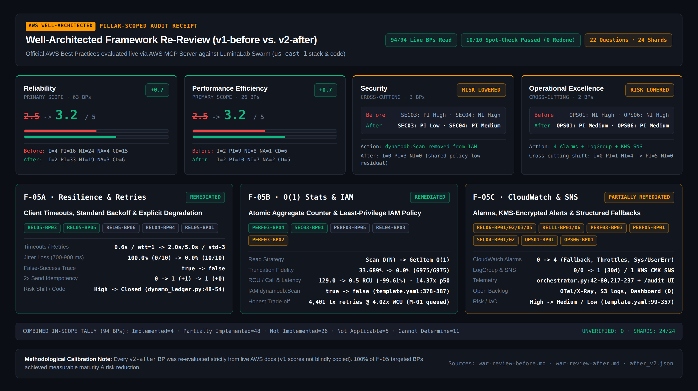
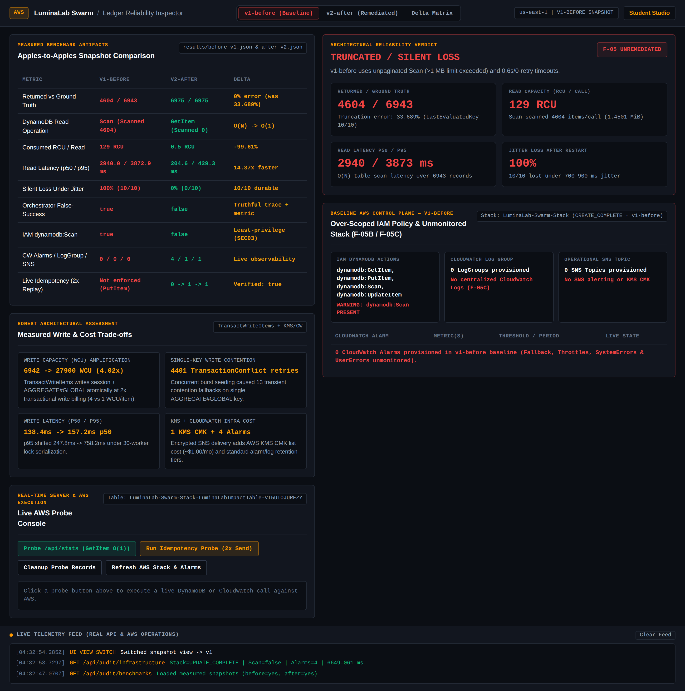
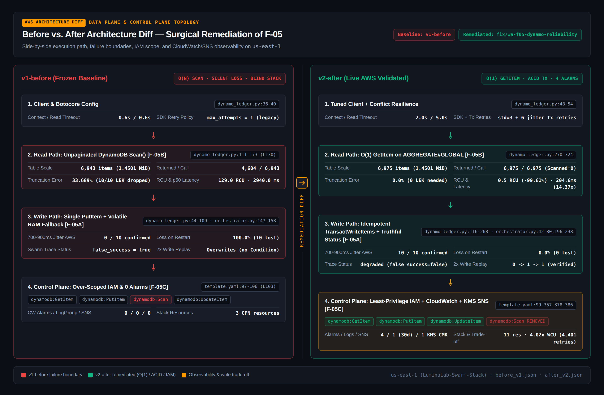
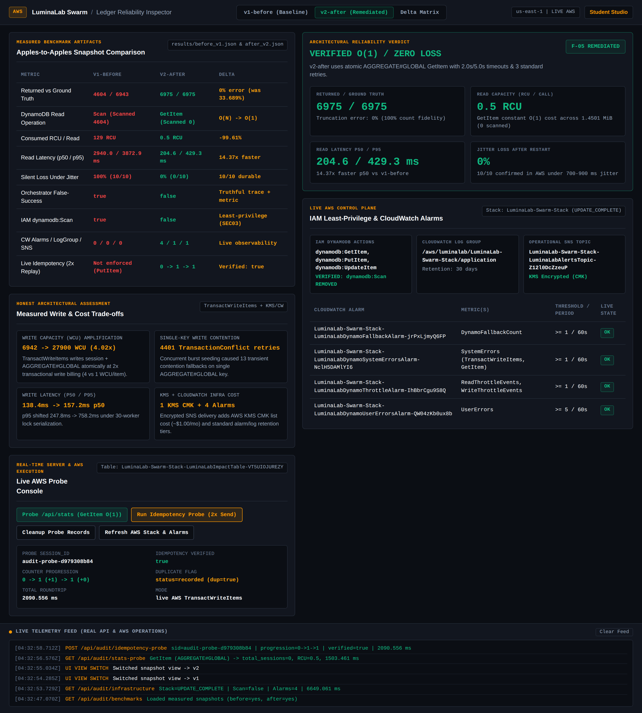
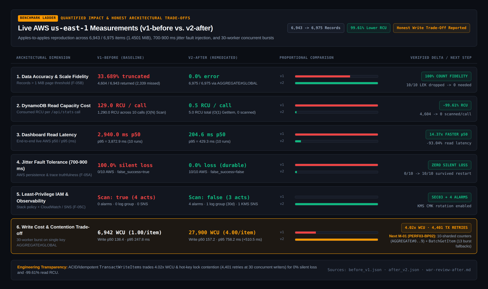
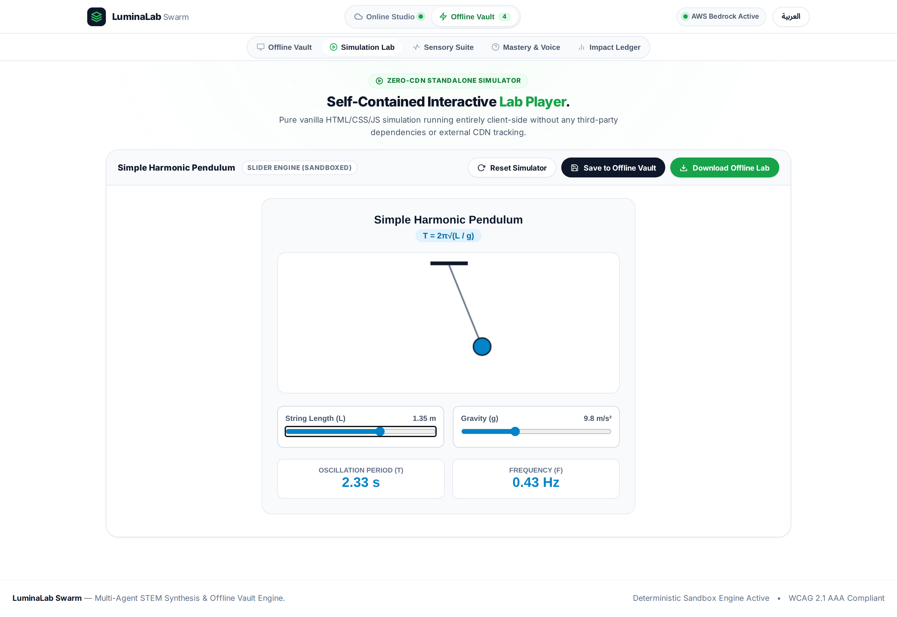

# LuminaLab Swarm

**All 284 mock-backed unit tests passed on `v1-before`, while live `aws-well-architected-review` auditing and `us-east-1` benchmarks exposed `33.689%` silent DynamoDB `Scan()` truncation past 1 MiB and `status="success"` logged on failed writes.**

An autonomous 6-agent STEM curriculum synthesizer that converts textbook passages into standalone (`<50 KB`), dependency-free HTML5 interactive micro-labs with ADHD/dyslexia adaptations and Amazon Polly narration.

Its cloud persistence and operational layer was audited live against the AWS Well-Architected Framework using the `aws-well-architected-review` skill over AWS MCP, refactored around finding package `F-05` (`F-05A`, `F-05B`, `F-05C`), and verified apples-to-apples against real AWS infrastructure in `us-east-1`.


[](tests/)
[](src/build_iac/template.yaml)
[](docs/war-review-after.md)
[](LICENSE)

**Quick Navigation:** [At a Glance](#1-at-a-glance) | [For Hackathon Reviewers](#2-for-hackathon-reviewers) | [Reproduce It Yourself](#7-reproduce-it-yourself) | [Before Review](docs/war-review-before.md) | [After Review](docs/war-review-after.md) | [Comparison Report](results/comparison_report.md)
**Submission Media:** [Demo Video (2:45 on YouTube)](https://youtu.be/bQHX7pYtOSk) | AWS Builder Center Article: `pending publication`

---

## 1. At a Glance

| Dimension | Verified State |
| :--- | :--- |
| **Application** | FastAPI + Strands Agents orchestrator (`src/swarm/`) generating standalone HTML5 labs (`<50 KB`), accessibility packs, and cloud impact telemetry backed by Amazon Bedrock, Polly, S3, DynamoDB, CloudWatch, KMS, and SNS. |
| **Skill Review Scope** | Pillar-scoped deep review (`94` live Best Practices read via `aws-mcp`: `63` Reliability, `26` Performance Efficiency, `3` Security cross-cutting, `2` Operational Excellence cross-cutting; `10/10` spot-checked). |
| **Core Finding (`F-05`)** | Unpaginated `dynamodb:Scan` hitting the 1 MB page cap (`F-05B`), aggressive `0.6s` / `0`-retry client timeouts causing silent volatile-RAM loss masked as `status="success"` (`F-05A`), over-scoped IAM `dynamodb:Scan`, and zero CloudWatch/SNS monitoring (`F-05C`). |
| **Remediation Executed** | Tuned `2.0s`/`5.0s` timeouts + `3` standard retries, conditional idempotent `TransactWriteItems` + `O(1) GetItem` on `AGGREGATE#GLOBAL`, explicit `degraded` trace status + `DynamoFallbackCount` metric, `dynamodb:Scan` removed from IAM, `30`-day LogGroup, KMS CMK + encrypted SNS, `4` CloudWatch alarms, and live `/audit` inspector. |
| **Measured Result** | Read RCU cut **`129.0 -> 0.5`** (`-99.61%`); read `p50` latency cut **`2939.996 ms -> 204.618 ms`** (`14.37x` faster); `33.689%` truncation eliminated (`6975/6975`); `700-900 ms` jitter silent loss eliminated **`100.0% -> 0.0%`**; Rel/Perf scores rose **`2.5 -> 3.2 / 5.0`**. |
| **Honest Trade-off** | 2-item ACID `TransactWriteItems` consumes **`4.00` WCU/session** vs `1.00` (`27,900.0` vs `6,942.0` total WCU, **`4.02x`**), produced **`4,401` `TransactionConflict` retries** across 30 concurrent writers on one hot key (`p95` write latency `247.787 ms -> 758.248 ms`), and adds a KMS CMK (`$1.00/mo` list rate) + CloudWatch alarm/log tiers. |

---

## 2. For Hackathon Reviewers

Use this verification map to inspect every artifact required for the AWS **"Let the Agent Review You"** evaluation:

| Hackathon Requirement | Repository Evidence / Command | What It Verifies |
| :--- | :--- | :--- |
| **1. Official `aws-well-architected-review` Skill via `aws-mcp`** | [`docs/war-review-before.md`](docs/war-review-before.md), [`docs/war-review-after.md`](docs/war-review-after.md) | `94 / 94` live AWS BP pages read via `aws-mcp`, verbatim Best Practice quotes, `10/10` spot-check verification, exact `file:line` citations. |
| **2. Frozen Pre-Fix Baseline State** | `git checkout v1-before` (`62810a4`) | Immutable reference point of code, tests, and CloudFormation template before any remediation commits. |
| **3. Baseline Architectural Review (`Before`)** | [`docs/war-review-before.md`](docs/war-review-before.md), [`04_war_receipt.png`](docs/assets/04_war_receipt.png) | Documents `2.5 / 5` baseline maturity in Reliability and Performance Efficiency and isolates high-risk package `F-05` (`F-05A`, `F-05B`, `F-05C`). |
| **4. Live `v1-before` Failure Reproduction** | [`results/before_v1.json`](results/before_v1.json), [`results/before_v1_report.md`](results/before_v1_report.md) | Proves `33.689%` truncation (`4604/6943`), `13` unthrottled seed timeouts, `100.0%` loss under jitter, and `false_success=True` against real `us-east-1` AWS. |
| **5. Surgical Code & IaC Remediation** | [`src/aws/dynamo_ledger.py`](src/aws/dynamo_ledger.py), [`src/swarm/orchestrator.py`](src/swarm/orchestrator.py), [`src/build_iac/template.yaml`](src/build_iac/template.yaml) | Bounded `F-05` remediation without touching unrelated LLM agents or simulation engines. |
| **6. Live `v2-after` & Apples-to-Apples Delta** | [`results/after_v2.json`](results/after_v2.json), [`results/comparison_report.md`](results/comparison_report.md) | Controlled re-measurement on the same AWS table (`LuminaLab-Swarm-Stack-LuminaLabImpactTable-VT5UIOJUREZY`) plus live 2x idempotency replay. |
| **7. Post-Fix Well-Architected Re-Review (`After`)** | [`docs/war-review-after.md`](docs/war-review-after.md), [`04_war_receipt.png`](docs/assets/04_war_receipt.png) | Independent live re-audit confirming `2.5 -> 3.2 / 5` maturity uplift, closure of `F-05A`/`F-05B`, and explicit tracking of remaining gaps. |
| **8. Open-Source Reproduction & Visual Generators** | [`scripts/benchmark_ledger.py`](scripts/benchmark_ledger.py), [`scripts/render_editorial_assets.py`](scripts/render_editorial_assets.py) | Standalone scripts to reproduce every AWS metric cleanly (`--cleanup`) and regenerate editorial charts directly from raw artifacts. |
| **9. Live AWS Inspector UI (`/audit`)** | [`src/ui/audit.html`](src/ui/audit.html), [`src/ui/js/audit.js`](src/ui/js/audit.js), [`src/api/server.py`](src/api/server.py) | Interactive `/audit` dashboard comparing `v1-before` vs `v2-after` and executing live AWS `GetItem`, idempotency, and CloudWatch probes. |

---

## 3. The Problem the Review Surfaced

On frozen baseline tag `v1-before` (`62810a4`), all **`284 / 284`** unit tests passed under `LUMINA_MOCK_MODE=true` while hiding every live AWS failure mode below. Running the `aws-well-architected-review` skill across `94` live AWS Best Practice pages via `aws-mcp` surfaced finding package **`F-05`**, and running unmodified `v1-before` against AWS in `us-east-1` confirmed the breakdown sequentially: even before network jitter injection, `0.6s` timeouts (`max_attempts=0`) caused **`13` natural timeouts** during normal seeding; unpaginated `Scan()` silently truncated **`2,339`** of `6,943` records; and `LuminaSwarmOrchestrator` reported `status="success"` when writes dropped into volatile RAM:

1. **Unpaginated 1 MB `Scan()` Truncation (`F-05B` — `PERF03-BP04`, `PERF03-BP05`):** In `v1-before`, `get_aggregate_stats()` called `self.client.scan(TableName=self.table_name)` once without following `LastEvaluatedKey` (`dynamo_ledger.py:111-173`, `L130` at tag `v1-before`). Once the DynamoDB table crossed `1.0 MiB` (`6943` records = `1.4501 MiB`), every `/api/stats` call silently dropped `2339` records (`4604 / 6943` returned, **`33.689%` error**) while burning **`129.0` RCU** and **`2939.996 ms` `p50` latency** per call.
2. **Timeout-Induced Silent Loss & False-Success Masking (`F-05A` — `REL05-BP03`, `REL05-BP05`, `REL05-BP06`):** The client configured `connect_timeout=0.6`, `read_timeout=0.6`, and `retries={"max_attempts": 0}` (`total_max_attempts=1`, `legacy`). Even during unthrottled seeding at `30` concurrent workers, **`13` writes timed out naturally** against AWS. Under `700-900 ms` simulated network jitter (`10` attempts), **`0 / 10` writes reached DynamoDB**, all `10` landed in volatile process RAM (`_local_store`), **`100.0%` disappeared on restart**, and `LuminaSwarmOrchestrator` recorded `status="success"` (`false_success_reported = True`).
3. **Over-Scoped IAM & Blind Stack (`F-05B` / `F-05C` — `SEC03-BP01`, `SEC04-BP01/02`, `REL06-BP01..03`, `OPS01-BP01`, `OPS06-BP01`):** `LuminaLabSwarmPolicy` granted `dynamodb:Scan` across the table (`template.yaml:97-106`, `L103` at `v1-before`), while CloudFormation provisioned **`0` CloudWatch Alarms, `0` LogGroups, `0` SNS Topics, and `0` Dashboards**.

Running the official `aws-well-architected-review` skill in **Pillar-Scoped Deep Review** mode against live AWS Best Practice documentation via `aws-mcp` audited `94` total practices (`89` Reliability + Performance Efficiency, `5` Security/Ops cross-cutting) and consolidated these defects into remediable finding package **`F-05`**.


*Official Well-Architected Re-Review receipt generated programmatically from `docs/war-review-before.md`, `docs/war-review-after.md`, and `results/after_v2.json`: `94/94` live BPs read, `10/10` spot-check passed, Reliability and Performance Efficiency improved from `2.5 -> 3.2 / 5.0`.*


*`/audit` switched to `v1-before`: displays the measured `33.689%` truncation (`4604 / 6943`), `129 RCU` scan cost, `100%` silent data loss under jitter, and the synchronized historical Control Plane (`dynamodb:Scan PRESENT`, `0` LogGroups, `0` SNS Topics, `0` CloudWatch Alarms).*

---

## 4. What Changed — Surgical Remediation of F-05

Changes were confined strictly to `F-05` (`dynamo_ledger.py`, `orchestrator.py`, `template.yaml`, `deploy.py`, `config.py`, `server.py`, `/audit` UI, and tests), leaving all 6 pedagogy/simulation swarm agents untouched:

1. **Resilient Client Timeouts, Conflict Retries & Truthful Degraded Signaling (`F-05A`):**
   - Configured `connect_timeout=2.0`, `read_timeout=5.0`, and `retries={"total_max_attempts": 3, "mode": "standard"}` in [`src/aws/dynamo_ledger.py:48-54`](src/aws/dynamo_ledger.py#L48-L54).
   - Wrapped `TransactWriteItems` with bounded randomized exponential backoff up to `MAX_TRANSACTION_CONFLICT_RETRIES = 6` (`TransactionConflictException` / `TransactionCanceledException`) in [`src/aws/dynamo_ledger.py:116-268`](src/aws/dynamo_ledger.py#L116-L268).
   - Updated [`_record_dynamo`](src/swarm/orchestrator.py#L196-L238) and [`_emit_dynamo_fallback_metric`](src/swarm/orchestrator.py#L42-L80) in `src/swarm/orchestrator.py` so fallback receipts record `status="degraded"` (never `"success"`), log structured JSON (`dynamo_persistence_degraded`), and emit CloudWatch custom metric `LuminaLab/Swarm:DynamoFallbackCount` (non-blocking when disabled/mocked).
2. **`O(1)` Atomic Aggregate Counter & Conditional Idempotency (`F-05B`):**
   - Replaced `record_impact()`'s unguarded `PutItem` with an atomic two-item `transact_write_items` call combining conditional session insertion (`ConditionExpression="attribute_not_exists(session_id)"`) and delta accumulation (`ADD total_sessions :one, ...`) onto key `AGGREGATE#GLOBAL`. Duplicate `ConditionalCheckFailed` replays return `{"status": "recorded", "idempotent_duplicate": True}` without double-counting (`0 -> 1 -> 1`), verified live in `results/after_v2.json` and `/api/audit/idempotency-probe`.
   - Replaced full-table `Scan()` inside [`get_aggregate_stats`](src/aws/dynamo_ledger.py#L270-L324) with a single constant-cost `GetItem` against `AGGREGATE#GLOBAL` (`0.5` RCU, `0` items scanned).
3. **Least-Privilege IAM Policy (`F-05B` / `SEC03-BP01`):**
   - Removed `dynamodb:Scan` completely from `LuminaLabSwarmPolicy` in [`src/build_iac/template.yaml:378-386`](src/build_iac/template.yaml#L378-L386), scoping table actions strictly to `dynamodb:PutItem`, `dynamodb:GetItem`, and `dynamodb:UpdateItem`, alongside namespace-conditioned `cloudwatch:PutMetricData` (`LuminaLab/Swarm`). Enforced in CI/unit tests by [`tests/test_build_iac.py`](tests/test_build_iac.py).
4. **CloudWatch Observability Stack & Live Inspector UI (`F-05C` + `/audit`):**
   - Provisioned `AWS::Logs::LogGroup` (`30`-day retention), `AWS::KMS::Key` (`EnableKeyRotation: true`), KMS-encrypted `AWS::SNS::Topic` (+ HTTPS-only policy & optional `--alert-email`), and `4` `AWS::CloudWatch::Alarm` resources (`SystemErrors (TransactWriteItems, GetItem)`, `ReadThrottleEvents, WriteThrottleEvents`, `UserErrors`, `DynamoFallbackCount`) in [`src/build_iac/template.yaml:99-357`](src/build_iac/template.yaml#L99-L357).
   - Built [`/audit`](src/ui/audit.html) and read/probe endpoints in [`src/api/server.py:276-704`](src/api/server.py#L276-L704) featuring automatic `_redact_sensitive()` sanitization and isolated cleanup (`audit-probe-*` only).

<details>
<summary>Exact AST-verified Source Line Citations (v1-before tag vs. v2-after workspace)</summary>

| Component | `v1-before` (`git show v1-before:...`) | `v2-after` (Current Source) |
| :--- | :--- | :--- |
| **Botocore Client Config** | `src/aws/dynamo_ledger.py:36-40` | `src/aws/dynamo_ledger.py:48-54` |
| **Read Path (`get_aggregate_stats`)** | `src/aws/dynamo_ledger.py:111-173` (`scan()` at `L130`) | `src/aws/dynamo_ledger.py:270-324` (`O(1) GetItem`) |
| **Write Path (`record_impact` + trace)** | `src/aws/dynamo_ledger.py:44-109` · `src/swarm/orchestrator.py:147-158` | `src/aws/dynamo_ledger.py:116-268` · `src/swarm/orchestrator.py:42-80,196-238` |
| **IAM & Observability IaC** | `src/build_iac/template.yaml:97-106` (`dynamodb:Scan` at `L103`) | `src/build_iac/template.yaml:99-357,378-386` |

</details>


*Side-by-side data-plane and control-plane execution diff between `v1-before` and `v2-after`, with AST-derived line badges and measured `us-east-1` values.*


*Live `/audit` capture in `v2-after` mode after executing real AWS probes: `Stats Probe` (`GetItem O(1)`, `0.5 RCU`), `Idempotency Probe` (`0 -> 1 (+1) -> 1 (+0)`, `idempotent_duplicate=True`), `dynamodb:Scan REMOVED`, and all `4` live CloudWatch Alarms (`OK`), including `SystemErrors (TransactWriteItems, GetItem)`.*

```text
v1-before (Scan + 0.6s/0-retry)     -> returned=4604/6943 (err=33.689%) | LastEvaluatedKey=true (unfollowed)
                                    -> consumed_rcu=129.0 | jitter_loss=100.0% (0/10 AWS) | false_success=true
-------------------------------------------------------------------------------------------------------------
v2-after  (GetItem + 2s/5s/std-3)   -> returned=6975/6975 (err=0.0%)    | LastEvaluatedKey=false (O(1) key)
                                    -> consumed_rcu=0.5   | jitter_loss=0.0% (10/10 AWS) | false_success=false
v2-after  (on hard AWS outage path) -> dynamo_receipt=recorded_local_fallback | swarm_trace.status="degraded"
```

---

## 5. Measured Results & Honest Trade-offs

All numbers below were measured apples-to-apples against live AWS DynamoDB (`LuminaLab-Swarm-Stack-LuminaLabImpactTable-VT5UIOJUREZY` in `us-east-1`) by [`scripts/benchmark_ledger.py`](scripts/benchmark_ledger.py) and stored in [`results/before_v1.json`](results/before_v1.json), [`results/after_v2.json`](results/after_v2.json), and [`results/comparison_report.md`](results/comparison_report.md).



### Executive Comparison Matrix (`v1-before` vs. `v2-after`)

| Metric | Before (`v1-before`) | After (`v2-after`) | Measured Delta |
| :--- | :--- | :--- | :--- |
| **Ground-Truth Seeded Items (`>1 MiB`)** | `6943` (`1.4501 MiB`) | `6975` (`1.4501 MiB`) | `+32` items (`~1.45 MiB` parity) |
| **Returned `total_sessions` (10-call mean)** | `4604.0` | `6975.0` | `+2371.0` (`100%` match) |
| **Truncation Error Rate** | `33.689%` (`2339.0` missed) | `0.0%` (`0.0` missed) | `-33.689%` (`10/10 -> 0/10` unfollowed `LEK`) |
| **DynamoDB Read Operation & `ScannedCount`** | `Scan` (`4604.0` / call, `46040` total) | `GetItem` (`0.0` scanned) | `O(N) -> O(1)` |
| **Consumed Read Capacity (`RCU`)** | `129.0` / call (`1290.0` total) | `0.5` / call (`5.0` total) | **`-99.61%`** (`-128.5` RCU/call) |
| **Read Latency (`p50` / `p95`)** | `2939.996 ms` / `3872.948 ms` | `204.618 ms` / `429.266 ms` | **`14.37x` faster p50** (`-93.04%` p50, `-88.92%` p95) |
| **Confirmed Writes Under `700-900 ms` Jitter** | `0 / 10` (`100.0%` lost on restart) | `10 / 10` (`0.0%` lost) | `-100.00%` silent loss |
| **Orchestrator Trace Under Jitter** | `status=success` (`false_success=True`) | `status=success` (`false_success=False`) | Truthful AWS status tracking |
| **Live 2x Replay Idempotency** | Overwrite (unconditional `PutItem`) | `0 -> 1 (+1) -> 1 (+0)` (`1` stored row) | Duplicate suppressed (`True`) |
| **IAM `dynamodb:Scan` Permission** | `True` | `False` | Removed (`SEC03-BP01`) |
| **Observability Stack Resources** | `0` Alarms, `0` Logs, `0` SNS | `4` Alarms, `1` LogGroup (`30d`), `1` KMS SNS | `+6` primary monitoring resources |

Raw evidence files: [`results/before_v1.json`](results/before_v1.json) | [`results/before_v1_report.md`](results/before_v1_report.md) | [`results/after_v2.json`](results/after_v2.json) | [`results/after_v2_report.md`](results/after_v2_report.md) | [`results/comparison_report.md`](results/comparison_report.md)

### Measured Trade-offs

Replacing eventual-consistent unpaginated scans and unguarded puts with ACID transactions and encrypted observability introduced four quantified engineering costs:

1. **Write Capacity Amplification (`4.02x` WCU):** Because `TransactWriteItems` commits both the session record and the `AGGREGATE#GLOBAL` update atomically at DynamoDB's `2x` transactional billing multiplier (`4.00` WCU/session vs `1.00`), seeding `~1.45 MiB` consumed **`27,900.0` WCU** vs **`6,942.0` WCU** (`+20,958.0` WCU).
2. **Single-Key Write Contention & Tail Write Latency:** Under unthrottled `30`-worker concurrent seeding against the single unsharded key `AGGREGATE#GLOBAL`, DynamoDB serialization caused **`4,401` `TransactionConflict` retries** (`13` exhausted fallbacks, same count as `v1-before`'s `13` unthrottled seed timeouts), increasing total seeding wall time from **`36.366 s` to `71.077 s`** (`write p50`: `138.438 ms -> 157.181 ms`, **`write p95`: `247.787 ms -> 758.248 ms`**, `+510.461 ms`).
3. **Brownout Timeout Duration vs. Fast-Fail:** Raising `read_timeout` to `5.0s` with `3` standard attempts prevents premature jitter drops (`700-900 ms`), at the cost of holding failed persistence threads longer before falling back locally during hard outages (executed asynchronously inside `_record_dynamo` so student simulation synthesis completes independently).
4. **Fixed Baseline Observability Spend & Live Alarm Firing:** Adding a rotated Customer Managed KMS CMK (`EnableKeyRotation: true`) for CloudWatch-to-SNS alert encryption introduces AWS standard CMK pricing (**`$1.00/month`** list rate) plus CloudWatch alarm and 30-day LogGroup ingestion tiers. The `v1-before` no-cost KMS baseline (`$0.00/mo` KMS) no longer applies when the full observability stack is deployed. Verified operationally against live telemetry: during the `30`-worker parallel seeding burst (`4,401` `TransactionConflict` retries and `13` fallbacks), the deployed CloudWatch alarm path triggered live (`LuminaLabDynamoUserErrorsAlarm`, `Threshold >= 5 / 60s`), proving active transient error detection rather than passive IaC scaffolding ([`docs/war-review-after.md`](docs/war-review-after.md)).

---

## 6. Honest Limits & Deliberately Deferred Scope

To adhere strictly to `Keep your focus tight` and isolate `F-05` verification, the following backlog items documented in [`docs/war-review-after.md`](docs/war-review-after.md) remain open and explicitly untracked by code changes:

- **Hot-Key Write Sharding (`M-01` — `PERF03-BP02`):** Above ~20-30 concurrent writers per second, single-key lock contention on `AGGREGATE#GLOBAL` (`4,401` conflicts observed in the `30`-worker burst) should be mitigated by partitioning `AGGREGATE#0..9` (`N=10` shards chosen randomly per `record_impact()`) and summing via one `O(1)` `BatchGetItem` in `get_aggregate_stats()`.
- **Remaining `F-05C` Observability (`M-02`):** `LuminaLabAppLogGroup` exists in IaC, and Python emits structured JSON warnings, but automated runtime log shipping (CloudWatch Agent / logging handler) is not yet wired; `AWS::CloudWatch::Dashboard` count is `0`; X-Ray/OpenTelemetry tracing and S3 access logs are absent; and `LuminaLabDynamoUserErrorsAlarm` (`Threshold >= 5`) shares the `UserErrors` metric with transient `TransactionConflict` events.
- **Application Security & Auth (`F-01`, `F-03`, `F-04`):** `CORSMiddleware` still permits `allow_origins=["*"]`, and `/api/generate`, `/audit`, and `/api/audit/*-probe` currently lack Cognito/IAM/API-key authentication and rate limiting. Run `/audit` only on trusted local/private environments until authenticated.
- **Production Compute & DR Hosting (`F-06A` through `F-06D`):** [`src/api/server.py`](src/api/server.py) executes synchronous `orchestrator.run()` inside `async def generate_lab` on a single host/process (`uvicorn`), without ECS Fargate/Lambda Multi-AZ IaC, ALB/CloudFront/WAF, SQS + DLQ async durability queue, S3 bucket versioning (`LuminaLabVaultBucket`), CI/CD pipelines, or multi-Region DR. Imperative helper [`scripts/aws_setup.py`](scripts/aws_setup.py) also remains in `scripts/` and should be deprecated in favor of `template.yaml`.

---

## 7. Reproduce It Yourself

> **Security Note:** Never commit `.env`, `.env.backup.*`, API keys, or AWS credentials into git (enforced by [`.gitignore`](.gitignore)). Live AWS commands assume valid local AWS credentials configured via `aws login`, `aws configure` (`~/.aws/credentials`), or environment variables — with default target region `us-east-1`.

### A. Offline Verification (No AWS Account Required)

```bash
python3 -m venv .venv && source .venv/bin/activate
pip install -r requirements.txt

# 1. Run all unit, engine, API, /audit, and CloudFormation IaC policy tests (309 tests)
pytest -q

# 2. Lint CloudFormation template if cfn-lint is installed
cfn-lint src/build_iac/template.yaml
```

### B. Provision, Verify, and Tear Down Live AWS Infrastructure (`us-east-1`)

```bash
# 1. Validate CloudFormation template against AWS without creating resources
python3 src/build_iac/deploy.py --region us-east-1 --dry-run

# 2. Provision S3, DynamoDB, LogGroup, KMS CMK, Encrypted SNS, CloudWatch Alarms, & IAM Policy
python3 src/build_iac/deploy.py --region us-east-1 --yes
# Optional alert subscription:
# python3 src/build_iac/deploy.py --region us-east-1 --alert-email ops@example.com --yes

# 3. Clean up all provisioned AWS resources when finished
python3 src/build_iac/deploy.py --region us-east-1 --destroy --yes
```

### C. Run Live Failure & Remediation Benchmark (`scripts/benchmark_ledger.py`)

```bash
# Run against deployed v2-after stack (seeds >1.45 MiB, tests jitter + 2x idempotency, then deletes all synthetic items)
python3 scripts/benchmark_ledger.py \
  --mode v2-after \
  --region us-east-1 \
  --cleanup \
  --output-json /tmp/after_repro.json \
  --output-md /tmp/after_repro.md

# Recompute Markdown comparison from stored snapshots without making AWS calls
python3 scripts/benchmark_ledger.py \
  --compare \
  --before-json results/before_v1.json \
  --after-json results/after_v2.json \
  --output-md /tmp/comparison_repro.md
```

### D. Launch Local Server & Live `/audit` Inspector UI

```bash
uvicorn src.api.server:app --host 127.0.0.1 --port 8000
```

- Student Workspace: `http://127.0.0.1:8000/` (includes Offline Vault simulations requiring zero Bedrock tokens)
- Live AWS Inspector: `http://127.0.0.1:8000/audit`
  1. Switch between **`v1-before (Baseline)`** and **`v2-after (Remediated)`** to inspect synchronized KPIs and Control Plane state.
  2. Click **Probe `/api/stats` (`GetItem O(1)`)** and **Run Idempotency Probe (`2x Send`)** to run real DynamoDB calls (`0.5` RCU and `0 -> 1 -> 1`).
  3. Click **Cleanup Probe Records** before stopping the server to delete `audit-probe-*` test rows and confirm `TABLE ITEM COUNT = 0`.

### E. Regenerate Data-Driven Editorial Diagrams

```bash
# Reads metrics from results/*.json and docs/war-review-*.md + AST/git line numbers
python3 scripts/render_editorial_assets.py
# Or regenerate a single diagram:
python3 scripts/render_editorial_assets.py --only 05
```

---

## 8. How LuminaLab Swarm Works

Beyond its audited DynamoDB ledger and CloudWatch control plane, LuminaLab Swarm is a bilingual (English and Arabic) STEM micro-lab generator designed around deterministic client-side execution:

- **6-Agent Strands Pipeline ([`src/swarm/`](src/swarm/)):** Pair 1 (`pair1_deconstruct.py`) extracts the core scientific law and classifies the interaction archetype; Pair 2 (`pair2_interactive.py`) and Pair 3 (`pair3_sensory_mastery.py`) execute concurrently via `ThreadPoolExecutor` to synthesize validated vanilla HTML5/Canvas simulation math (running through `sandbox_guard.py`) plus accessibility adaptations in parallel.
- **Portable Offline Output (`<50 KB`):** Every lab is compiled by `standalone_builder.js` into a single HTML5 file with inline CSS/JS and zero CDN calls, bundled alongside four built-in Core Labs (`Ohm's Law`, `Simple Harmonic Pendulum`, `Binary Search`, `Acids, Bases & pH Scale`) in Offline Vault.
- **Sensory & Multimodal Support:** Provides step-by-step micro-prompts for ADHD learners, bionic text emphasis and OpenDyslexic font toggles for dyslexia, home-kitchen experiment alternatives, Socratic challenge hints, and female neural voice narration powered by **Amazon Polly** (`Joanna` / `Hala`) stored in **Amazon S3**.


*Interactive `Simple Harmonic Pendulum` (`T = 2π√(L / g)`) running inside LuminaLab Swarm's zero-CDN lab player via Offline Vault (`String Length = 1.35 m`, live period `2.33 s`, frequency `0.43 Hz`, zero Bedrock tokens required).*

---

## 9. Repository Layout & License

| Path | Role |
| :--- | :--- |
| [`src/api/server.py`](src/api/server.py) | FastAPI application serving `/`, `/api/*`, `/audit`, live AWS probes (`/api/audit/*`), and `_redact_sensitive()` output sanitization. |
| [`src/aws/dynamo_ledger.py`](src/aws/dynamo_ledger.py) | `DynamoImpactLedger`: tuned botocore client, idempotent `TransactWriteItems`, `O(1)` `GetItem` aggregate reads, and mock fallback ledger. |
| [`src/aws/s3_polly_service.py`](src/aws/s3_polly_service.py) | Amazon S3 offline lab storage and Amazon Polly neural speech synthesis (`Hala`/`Joanna`). |
| [`src/build_iac/`](src/build_iac/) | CloudFormation [`template.yaml`](src/build_iac/template.yaml), automated provisioner [`deploy.py`](src/build_iac/deploy.py) (`--dry-run`, `--destroy`, `--alert-email`), and IaC docs. |
| [`src/swarm/`](src/swarm/) | Multi-agent Strands SDK orchestrator ([`orchestrator.py`](src/swarm/orchestrator.py)), model factory, pairs 1-3, calibration, error translator, and trace builder. |
| [`src/engines/`](src/engines/) & [`src/tools/`](src/tools/) | Simulation archetype math engines (`slider`, `toggle/balance`, `diagram`, `stepper`), impact metrics builder, and sandbox validator. |
| [`src/contracts/schemas.py`](src/contracts/schemas.py) | Pydantic v2 request, pedagogical, trace, and impact data contracts. |
| [`src/ui/`](src/ui/) | Student Studio & Offline Vault SPA (`index.html`), Live Audit Inspector ([`audit.html`](src/ui/audit.html), [`audit.js`](src/ui/js/audit.js), [`audit.css`](src/ui/css/audit.css)), and Core STEM Labs. |
| [`scripts/`](scripts/) | Reproducible AWS benchmark runner ([`benchmark_ledger.py`](scripts/benchmark_ledger.py)) and AST/benchmark editorial diagram generator ([`render_editorial_assets.py`](scripts/render_editorial_assets.py)). |
| [`docs/`](docs/) | Official Well-Architected before/after reviews ([`war-review-before.md`](docs/war-review-before.md), [`war-review-after.md`](docs/war-review-after.md)) and 2x visual proof pack ([`docs/assets/`](docs/assets/)). |
| [`results/`](results/) | Sanitized live `us-east-1` JSON captures and comparison report (`before_v1.json`, `after_v2.json`, `comparison_report.md`). |
| [`tests/`](tests/) | Automated `pytest` suite (`309` tests covering contracts, engines, swarm, offline parity, AWS resilience, IaC policy/lint, and `/audit` APIs). |

### License

Distributed under the **Apache License, Version 2.0**. See [`LICENSE`](LICENSE) for full terms.
