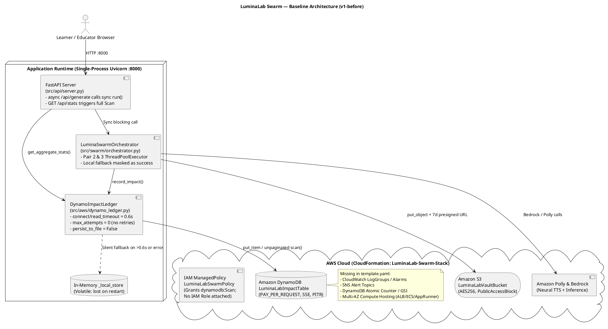

# Well-Architected Review: LuminaLab Swarm (Baseline `v1-before`)

> **Classification: CONFIDENTIAL (Sanitized for Public Reference)** — This baseline report documents pre-remediation architectural findings derived strictly from live AWS Well-Architected Framework documentation and repository source analysis at tag `v1-before`. All AWS Account IDs, IAM usernames, personal ARNs, API keys, tokens, and local workstation paths have been omitted or redacted.

---

## Coverage Audit

- **Review status:** COMPLETE — `89` of `89` in-scope Best Practices read in full across the requested pillars (`Reliability`: `63`, `Performance Efficiency`: `26`), plus `5` targeted cross-cutting Best Practices from `Security` and `Operational Excellence` (`SEC03-BP01`, `SEC04-BP01`, `SEC04-BP02`, `OPS01-BP01`, `OPS06-BP01`) for database permissions and monitoring (**Total live BP pages read: `94`**).
- **Run:** `wa-pillar-20261124T014200Z`, started `2026-11-24T01:42:00Z`, baseline git tag `v1-before` (`62810a4`).
- **Review Integrity:** `no embedded instructions found`
- **Review mode:** `pillar-scoped` (primary scope: `Reliability` + `Performance Efficiency`, `89` of `216` framework Cloud Workloads BPs; cross-cutting intersection: `Security` + `Operational Excellence` DB permissions & observability, `5` BPs).
- **BP pages read:** `89 / 89` in-scope BPs (`+ 5` cross-cutting BPs = `94` total pages read live via MCP).
- **Unreadable BP pages (`page_unreadable`):** `none` (cap `5`; user-accepted degraded run: `no`).
- **Read proof (agent-checked, not machine-verified):** `94` BP pages read in full via `aws___read_documentation` (`retrieval_method: mcp_read`, `web_fetch: 0`) with `end_index == total_length` and `truncated: false` verified against tool responses.
- **Read proof unverified:** `none`.
- **Spot-check:** `10` sampled pages re-read via `aws___read_documentation` (`REL05-BP01`, `REL06-BP01`, `REL11-BP01`, `REL01-BP01`, `REL04-BP01`, `REL07-BP01`, `REL09-BP01`, `REL12-BP01`, `PERF02-BP01`, `PERF05-BP01`), `10` passed, `0` shards redone (agent-checked against live MCP responses).
- **Corpus provenance:** `mcp_toc_index` from `https://docs.aws.amazon.com/wellarchitected/latest/framework/toc-contents.json` (`index_total_length: 34791`, retrieved `2026-11-24T01:42:00Z`; live Cloud Workloads inventory: `6` pillars, `50` questions, `216` Best Practices).
- **In-scope Status Distribution (`89` BPs):**
  - **Reliability (`63` BPs):** Implemented `4` · Partially Implemented `16` · Not Implemented `24` · Not Applicable `4` · Cannot Determine `15`
  - **Performance Efficiency (`26` BPs):** Implemented `2` · Partially Implemented `9` · Not Implemented `8` · Not Applicable `1` · Cannot Determine `6`
- **Files Analyzed (at `v1-before`):**
  - IaC & Provisioning: `src/build_iac/template.yaml`, `src/build_iac/deploy.py`, `src/build_iac/README.md`, `scripts/aws_setup.py`
  - AWS Adapters & Config: `src/aws/dynamo_ledger.py`, `src/aws/s3_polly_service.py`, `src/config.py`
  - API & Swarm Pipeline: `src/api/server.py`, `src/swarm/orchestrator.py`, `src/swarm/model_factory.py`, `src/swarm/error_translator.py`, `src/swarm/pair1_deconstruct.py`, `src/swarm/pair2_interactive.py`, `src/swarm/pair3_sensory_mastery.py`
  - Contracts, Tools, UI & Tests: `src/contracts/schemas.py`, `src/tools/sandbox_guard.py`, `src/tools/impact_calculator.py`, `src/ui/js/online/live_views.js`, `src/ui/js/online/swarm_client.js`, `tests/test_build_iac.py`, `tests/test_phase5_aws.py`, `requirements.txt`, `.env.example`, `.gitignore`

---

## Executive Summary

- **Date:** 2026-11-24
- **Workload:** LuminaLab Swarm — Multi-Agent Pedagogical STEM Micro-Lab Engine (`FastAPI` + `AWS Strands Agents SDK` + `Amazon Bedrock` + `Amazon Polly` + `Amazon S3` + `Amazon DynamoDB` + `AWS CloudFormation`)
- **Baseline Reference:** Git Tag `v1-before` (`62810a4`)
- **Business Criticality:** Standard (EdTech workload with live AWS cloud persistence path)
- **Lens Applied:** General (AWS Well-Architected Framework — Pillar-Scoped Deep Review: Reliability & Performance Efficiency + Security/Ops Intersections)
- **Questions Assessed:** `18 / 18` in-scope questions (`Reliability`: `13/13`, `Performance Efficiency`: `5/5`) + `4` cross-cutting questions (`SEC03`, `SEC04`, `OPS01`, `OPS06`)
- **Findings (within scoped pillars & cross-cutting F-05 focus):** `0` Critical (in Reliability/Performance scope; note secret/auth gaps belong to Security outside primary scope), `6` High, `5` Medium, `2` Low
- **Overall Scoped Maturity:** **2.5 / 5** — المشروع يعتمد بنية Serverless متقنة في تخزين البيانات (`DynamoDB PAY_PER_REQUEST + PITR` و`S3 AES256 + BlockPublicAccess`) وتنفيذاً متوازياً بين أزواج الوكلاء (`ThreadPoolExecutor`)، مع وجود فجوة رئيسية مركّزة في حزمة **`F-05`** (إعدادات `timeout/retries` العدوانية في DynamoDB، و`Scan` غير مقسم لصفحات لحساب الإحصاءات، وصلاحية `dynamodb:Scan` الزائدة، وغياب مراقبة وتنبيهات CloudWatch في الـ IaC)، إلى جانب غياب استضافة Multi-AZ للـ Compute في الـ IaC واستدعاء Orchestrator المتزامن داخل FastAPI async handler.

---

## Architecture Overview (Before State — `v1-before`)

---

## Pillar Scorecard (In-Scope Pillars + Cross-Cutting Context)

| Pillar | Scope Role | Score (1-5) | Questions Assessed | Key Strength | Key Gap |
| --- | --- | --- | --- | --- | --- |
| **Reliability** | **Primary Scope** | **2.5** | `13 / 13` (`63` BPs) | تفعيل `PointInTimeRecoveryEnabled: true` على DynamoDB (`src/build_iac/template.yaml:68-69`) وعزل مسار AWS في `orchestrator.py:143-177` حتى لا يتعطل توليد المختبر عند فشل التخزين. | **`F-05`:** مهلة `0.6s` و`max_attempts=0` في `dynamo_ledger.py:36-40` تسبب سقوطاً متكرراً وفقداناً صامتاً في `_local_store` بالذاكرة، وغياب CloudWatch Alarms (`REL06`), وتشغيل الخادم كعملية وحيدة بدون Multi-AZ (`REL10-BP01`). |
| **Performance Efficiency** | **Primary Scope** | **2.5** | `5 / 5` (`26` BPs) | تنفيذ Pair 2/3 بالتوازي (`orchestrator.py:35-40`)، وتنفيذ DynamoDB/S3 بالتوازي (`orchestrator.py:179-183`)، وضغط مخرجات HTML لأقل من 50 KB. | **`F-05`:** تنفيذ `client.scan()` غير مقسم لصفحات في `dynamo_ledger.py:130` على كل طلب `/api/stats` (`PERF03-BP04`) دون كاش (`PERF03-BP05`)، وحجب FastAPI Event Loop باستدعاء متزامن (`server.py:163`). |
| **Security** | Cross-Cutting (`SEC03`, `SEC04`) | — *(Cross-cutting)* | `2` focus questions (`SEC03-BP01`, `SEC04-BP01`, `SEC04-BP02`) | تفعيل `PublicAccessBlockConfiguration` (`template.yaml:42-46`) وتعقيم الأسرار من رسائل الأخطاء (`error_translator.py:13-30`). | **`F-05`:** وجود صلاحية `dynamodb:Scan` واسعة في `template.yaml:103` دون حاجة بمجرد اعتماد العداد الذري، وغياب CloudWatch Logs/Alarms للرصد الأمني (`SEC04-BP01`, `SEC04-BP02`). |
| **Operational Excellence** | Cross-Cutting (`OPS01`, `OPS06`) | — *(Cross-cutting)* | `2` focus questions (`OPS01-BP01`, `OPS06-BP01`) | أتمتة CloudFormation via `deploy.py` (`--dry-run`, `--destroy`) ووجود اختبارات `pytest` (`tests/`). | **`F-05`:** غياب Telemetry مركزي في CloudWatch (`OPS01-BP01`) وغياب التنبيهات الفعالة (`OPS06-BP01`) عند تراجع الكتابة إلى Fallback أو تصاعد أخطاء DynamoDB. |

---

## Per-Question Assessment (All 18 In-Scope Questions + Cross-Cutting Intersections)

### Reliability (13 / 13 Questions — `63` BPs Read)

| ID | Question | Status | Risk | Key Evidence (`file:line` & Worst BP ID) |
| --- | --- | --- | --- | --- |
| `REL01` | Manage service quotas and constraints | Not Implemented | Medium | `0` Implemented, `3` Not Implemented, `3` Cannot Determine — لا يوجد تتبع لحصص DynamoDB/Bedrock/Polly أو تنبيهات اقتراب من الحدود (`REL01-BP01`, `REL01-BP04`). |
| `REL02` | Plan your network topology | Not Implemented | High | `0` Implemented, `1` Not Implemented, `1` Not Applicable — خادم `src/api/server.py:258` يعمل على منفذ محلي `0.0.0.0:8000` بدون ALB/API Gateway/CloudFront (`REL02-BP01`). |
| `REL03` | Design your workload service architecture | Partially Implemented | Low | `2` Implemented, `1` Partially Implemented — فصل واضح بين العقود (`src/contracts/schemas.py`), الـ Orchestrator، وطبقة AWS؛ غياب versioning رسمي للـ API (`REL03-BP03`). |
| `REL04` | Design interactions in a distributed system to prevent failures | Partially Implemented | Medium | `1` Implemented, `2` Partially Implemented, `1` Cannot Determine — تصنيف المسار غير الحرج في `orchestrator.py:143`؛ توليد UUID عشوائي لكل TTS بدلاً من idempotency (`s3_polly_service.py:138`, `REL04-BP04`). |
| `REL05` | Design interactions in a distributed system to mitigate or withstand failures | Partially Implemented | **High** | `1` Implemented, `4` Partially Implemented, `2` Not Implemented — **`F-05`**: `dynamo_ledger.py:36-40` (`0.6s` timeout, `0` retries) يسبب سقوطاً اصطناعياً وفقداناً في `_local_store` (`REL05-BP05`, `REL05-BP03`, `REL05-BP06`). |
| `REL06` | Monitor workload resources | Not Implemented | **High** | `0` Implemented, `6` Not Implemented, `1` Cannot Determine — **`F-05`**: `src/build_iac/template.yaml:1-143` خالٍ من أي CloudWatch Metrics/Alarms/Logs/SNS/X-Ray (`REL06-BP01`, `REL06-BP03`, `REL06-BP07`). |
| `REL07` | Design your workload to adapt to changes in demand | Partially Implemented | High | `1` Implemented, `2` Partially Implemented, `1` Not Implemented — S3/DynamoDB في `template.yaml` يعتمدان CloudFormation و`PAY_PER_REQUEST` (`REL07-BP01`), لكن طبقة Compute بلا Auto Scaling أو Load Testing (`REL07-BP03`, `REL07-BP04`). |
| `REL08` | Implement change | Partially Implemented | High | `2` Partially Implemented, `3` Not Implemented — `deploy.py` يوفر `--dry-run` لكن بلا CI/CD pipeline أو linting آلي في المسار، مع وجود `scripts/aws_setup.py:28-74` المسبب للانحراف (`REL08-BP05`, `REL08-BP04`). |
| `REL09` | Back up data | Partially Implemented | Medium | `1` Implemented, `2` Partially Implemented, `2` Cannot Determine — تفعيل DynamoDB PITR (`template.yaml:68-69`, `REL09-BP03`)، لكن S3 بدون `VersioningConfiguration` ولا اختبارات استعادة (`REL09-BP01`, `REL09-BP04`). |
| `REL10` | Use fault isolation to protect your workload | Not Implemented | High | `0` Implemented, `2` Not Implemented, `1` Cannot Determine — تشغيل الخادم كعملية وحيدة في `server.py:258` بدون Multi-AZ أو استعادة آلية (`REL10-BP01`, `REL10-BP02`). |
| `REL11` | Design your workload to withstand component failures | Not Implemented | **High** | `0` Implemented, `5` Not Implemented, `2` Cannot Determine — **`F-05`**: غياب مراقبة الأعطال (`REL11-BP01`) وغياب إشعارات السقوط أو الاستبدال الآلي للـ Compute (`REL11-BP02`, `REL11-BP06`). |
| `REL12` | Test reliability | Partially Implemented | Medium | `1` Partially Implemented, `4` Not Implemented — وجود اختبارات وحدة/Mock (`tests/test_phase5_aws.py`), وغياب اختبارات الحمل وChaos وPlaybooks (`REL12-BP01`, `REL12-BP03`, `REL12-BP04`). |
| `REL13` | Plan for Disaster Recovery (DR) | Not Implemented | Medium | `0` Implemented, `3` Not Implemented, `2` Cannot Determine — عدم تحديد RTO/RPO أو استراتيجية DR موثقة (`REL13-BP01`, `REL13-BP02`). |

### Performance Efficiency (5 / 5 Questions — `26` BPs Read)

| ID | Question | Status | Risk | Key Evidence (`file:line` & Worst BP ID) |
| --- | --- | --- | --- | --- |
| `PERF01` | Validate workload performance requirements | Partially Implemented | Low | `1` Implemented, `1` Partially Implemented, `2` Not Implemented — قياس `generation_time_sec` و`lab_size_kb < 200` (`schemas.py:165`), لكن لا توجد SLOs أو تنبيهات تدهور الأداء (`PERF01-BP03`, `PERF01-BP04`). |
| `PERF02` | Compute and hardware | Partially Implemented | High | `1` Partially Implemented, `3` Not Implemented, `1` Not Applicable — التوازي في `orchestrator.py:35-40` ممتاز، لكن `server.py:163` يحجب الـ Event Loop بـ `orchestrator.run` المتزامن مع غياب Dynamic Scaling (`PERF02-BP01`, `PERF02-BP04`). |
| `PERF03` | Data management | Partially Implemented | **High** | `1` Implemented, `2` Partially Implemented, `2` Not Implemented — **`F-05`**: اختيار DynamoDB+S3 مناسب (`PERF03-BP01`), لكن `dynamo_ledger.py:130` ينفذ `scan()` بدون Pagination، وبلا Caching في `server.py:188-195` (`PERF03-BP04`, `PERF03-BP05`) وبلا Metrics (`PERF03-BP03`). |
| `PERF04` | Networking and content delivery | Partially Implemented | Medium | `1` Partially Implemented, `4` Not Implemented, `2` Cannot Determine — منع الكاش كلياً في `server.py:121-125` (`no-store`), وغياب CloudFront/ALB (`PERF04-BP04`, `PERF04-BP06`). |
| `PERF05` | Monitor, test, and improve workload performance | Not Implemented | High | `0` Implemented, `3` Not Implemented, `2` Cannot Determine — **`F-05`**: غياب CloudWatch Application Signals / X-Ray / OpenTelemetry لتتبع المسار الحرج بين FastAPI وBedrock وPolly وDynamoDB (`PERF05-BP01`, `PERF05-BP02`). |

### Cross-Cutting Intersections (`Security` & `Operational Excellence` — DB Permissions & Monitoring)

| ID | Pillar / Question | Status | Risk | Key Evidence (`file:line` & Official BP ID) |
| --- | --- | --- | --- | --- |
| `SEC03` | Permissions management (DB Scope) | Partially Implemented | **High** | `template.yaml:97-106` يمنح `dynamodb:Scan` على كامل `LuminaLabImpactTable` بسبب نمط القراءة في `dynamo_ledger.py:130` (`SEC03-BP01`). |
| `SEC04` | Detection (DB & App Monitoring) | Not Implemented | **High** | `template.yaml:1-143` يفتقر لـ CloudWatch Logs/Alarms وS3 Access Logging وCloudTrail data events (`SEC04-BP01`, `SEC04-BP02`). |
| `OPS01` | Observe from multiple perspectives | Not Implemented | **High** | `server.py:19-27` يطبع لـ `stdout` فقط؛ لا CloudWatch custom metrics أو OpenTelemetry traces لأخطاء DynamoDB أو Latency (`OPS01-BP01`). |
| `OPS06` | Create an effective event response | Not Implemented | **High** | غياب أي CloudWatch Alarms أو SNS Notifications في `template.yaml` عند سقوط DynamoDB أو ارتفاع `UserErrors`/`SystemErrors` (`OPS06-BP01`). |

---

## Compact BP Ledger (`89` In-Scope BPs + `5` Cross-Cutting BPs)

> **Evidence Note:** Every BP status below was assigned after reading its full live page via `aws___read_documentation` (`truncated: false`, `end_index == total_length`).

| Pillar / Group | Implemented | Partially Implemented | Not Implemented | Not Applicable | Cannot Determine |
| --- | --- | --- | --- | --- | --- |
| **Reliability (`63` BPs)** | `4` (`REL03-BP01`, `REL03-BP02`, `REL04-BP01`, `REL09-BP03`) | `16` (incl. `REL05-BP03`, `REL05-BP05`, `REL05-BP06` — High; see full ledger below) | `24` (incl. `REL02-BP01`, `REL05-BP02`, `REL06-BP01..03`, `REL07-BP03`, `REL10-BP01`, `REL11-BP01..02`, `REL11-BP06` — High) | `4` (`REL01-BP02`, `REL02-BP02`, `REL10-BP02`, `REL13-BP04`) | `15` (see full ledger below) |
| **Performance Efficiency (`26` BPs)** | `2` (`PERF01-BP01`, `PERF03-BP01`) | `9` (incl. `PERF02-BP01`, `PERF03-BP04`, `PERF03-BP05` — High) | `8` (incl. `PERF02-BP04`, `PERF03-BP03`, `PERF04-BP04`, `PERF05-BP01` — High) | `1` (`PERF04-BP03`) | `6` (see full ledger below) |
| **Cross-Cutting (`5` BPs)** | `0` | `1` (`SEC03-BP01` — High) | `4` (`SEC04-BP01`, `SEC04-BP02`, `OPS01-BP01`, `OPS06-BP01` — High) | `0` | `0` |

Complete Canonical BP-by-BP Ledger (All 89 In-Scope BPs + 5 Cross-Cutting BPs)

| BP ID | Status | Risk | BP ID | Status | Risk |
| --- | --- | --- | --- | --- | --- |
| `REL01-BP01` | Not Implemented | Medium | `REL08-BP05` | Partially Implemented | Medium |
| `REL01-BP02` | Not Applicable | — | `REL09-BP01` | Partially Implemented | Medium |
| `REL01-BP03` | Not Implemented | Medium | `REL09-BP02` | Partially Implemented | Medium |
| `REL01-BP04` | Not Implemented | Medium | `REL09-BP03` | Implemented | — |
| `REL01-BP05` | Cannot Determine | — | `REL09-BP04` | Cannot Determine | — |
| `REL01-BP06` | Cannot Determine | — | `REL09-BP05` | Cannot Determine | — |
| `REL02-BP01` | Not Implemented | High | `REL10-BP01` | Not Implemented | High |
| `REL02-BP02` | Not Applicable | — | `REL10-BP02` | Not Applicable | — |
| `REL03-BP01` | Implemented | — | `REL10-BP03` | Cannot Determine | — |
| `REL03-BP02` | Implemented | — | `REL11-BP01` | Not Implemented | High |
| `REL03-BP03` | Partially Implemented | Low | `REL11-BP02` | Not Implemented | High |
| `REL04-BP01` | Implemented | — | `REL11-BP03` | Partially Implemented | Medium |
| `REL04-BP02` | Partially Implemented | Medium | `REL11-BP04` | Cannot Determine | — |
| `REL04-BP03` | Cannot Determine | — | `REL11-BP05` | Partially Implemented | Medium |
| `REL04-BP04` | Partially Implemented | Medium | `REL11-BP06` | Not Implemented | High |
| `REL05-BP01` | Partially Implemented | Medium | `REL11-BP07` | Cannot Determine | — |
| `REL05-BP02` | Not Implemented | High | `REL12-BP01` | Not Implemented | Medium |
| `REL05-BP03` | Partially Implemented | High | `REL12-BP02` | Cannot Determine | — |
| `REL05-BP04` | Not Implemented | Medium | `REL12-BP03` | Not Implemented | Medium |
| `REL05-BP05` | Partially Implemented | High | `REL12-BP04` | Cannot Determine | — |
| `REL05-BP06` | Partially Implemented | High | `REL12-BP05` | Cannot Determine | — |
| `REL05-BP07` | Cannot Determine | — | `REL13-BP01` | Not Implemented | Medium |
| `REL06-BP01` | Not Implemented | High | `REL13-BP02` | Not Implemented | Medium |
| `REL06-BP02` | Not Implemented | High | `REL13-BP03` | Cannot Determine | — |
| `REL06-BP03` | Not Implemented | High | `REL13-BP04` | Not Applicable | — |
| `REL06-BP04` | Not Implemented | Medium | `REL13-BP05` | Cannot Determine | — |
| `REL06-BP05` | Not Implemented | Medium | `PERF01-BP01` | Implemented | — |
| `REL06-BP06` | Cannot Determine | — | `PERF01-BP02` | Partially Implemented | Low |
| `REL06-BP07` | Not Implemented | Medium | `PERF01-BP03` | Not Implemented | Low |
| `REL07-BP01` | Partially Implemented | Medium | `PERF01-BP04` | Not Implemented | Medium |
| `REL07-BP02` | Partially Implemented | Medium | `PERF02-BP01` | Partially Implemented | High |
| `REL07-BP03` | Not Implemented | High | `PERF02-BP02` | Not Implemented | Medium |
| `REL07-BP04` | Not Implemented | Medium | `PERF02-BP03` | Partially Implemented | Low |
| `REL08-BP01` | Partially Implemented | Low | `PERF02-BP04` | Not Implemented | High |
| `REL08-BP02` | Partially Implemented | Medium | `PERF02-BP05` | Cannot Determine | — |
| `REL08-BP03` | Not Implemented | Medium | `PERF03-BP01` | Implemented | — |
| `REL08-BP04` | Not Implemented | Medium | `PERF03-BP02` | Partially Implemented | Medium |
| `PERF03-BP03` | Not Implemented | High | `PERF04-BP06` | Cannot Determine | — |
| `PERF03-BP04` | Partially Implemented | High | `PERF04-BP07` | Cannot Determine | — |
| `PERF03-BP05` | Partially Implemented | High | `PERF05-BP01` | Not Implemented | High |
| `PERF04-BP01` | Partially Implemented | Low | `PERF05-BP02` | Not Implemented | Medium |
| `PERF04-BP02` | Partially Implemented | Medium | `PERF05-BP03` | Cannot Determine | — |
| `PERF04-BP03` | Not Applicable | — | `PERF05-BP04` | Cannot Determine | — |
| `PERF04-BP04` | Not Implemented | High | `PERF05-BP05` | Cannot Determine | — |
| `PERF04-BP05` | Partially Implemented | Low | `SEC03-BP01` | Partially Implemented | High |
| `SEC04-BP01` | Not Implemented | High | `SEC04-BP02` | Not Implemented | High |
| `OPS01-BP01` | Not Implemented | High | `OPS06-BP01` | Not Implemented | High |

---

## High Risk Findings (Expanded — F-05 Deep-Dive & Scoped Pillar Gaps)

### F-05A [HIGH] — إعدادات DynamoDB timeout عدوانية (`0.6s`) مع تعطيل Retries وفقدان صامت للبيانات في الذاكرة المحلية
- **Pillars:** Reliability (Cross-cutting: Operational Excellence)
- **Official BP IDs:** `REL05-BP05`, `REL05-BP03`, `REL05-BP06`, `REL05-BP01`
- **Quoted Live AWS Guidance:**
  - `REL05-BP05`: *"Timeouts set too low cause artificial failures and retry-driven traffic increases."* / *"A timeout shorter than a request's normal completion time manufactures failures out of requests that would have succeeded."*
  - `REL05-BP03`: *"Your retries use exponential backoff with jitter and a maximum attempt or elapsed-time limit."*
  - `REL05-BP06`: *"Applications store session data on the local disk or in the memory of the node that handled the first request."*
- **Evidence (`file:line`):**
  - `src/aws/dynamo_ledger.py:36-40` — ضبط عميل boto3 DynamoDB على `connect_timeout=0.6`, `read_timeout=0.6`, و`retries={"max_attempts": 0}`.
  - `src/aws/dynamo_ledger.py:18, 97-109` — عند فشل الاتصال أو تجاوز `0.6s`، يُكتب السجل في `self._local_store` بالذاكرة مع `persist_to_file=False` (المستدعى في `src/api/server.py:108`)، فتضيع السجلات تماماً عند إعادة تشغيل العملية.
  - `src/swarm/orchestrator.py:153-155` — يقبل `recorded_local_fallback` كـ `status = "success"` في `swarm_trace`، ما يخفي فشل الكتابة السحابية تماماً.
- **Impact Assessment:** **Impact Moderate, Likelihood High** — استهلاك TLS handshake أو تأخير شبكي عابر (> 600ms) يكفي لإفشال `put_item` و`scan` دون أي محاولة إعادة، مع فقدان صامت لسجلات التأثير التربوي بمجرد إعادة التشغيل.
- **Recommendation (تفصيل الحل):**
  1. تعديل `botocore.config.Config` في `DynamoImpactLedger` إلى قيم قياسية متوازنة (مثل `connect_timeout=2.0`, `read_timeout=5.0`, `retries={"max_attempts": 3, "mode": "standard"}`) لتفعيل Exponential Backoff with Jitter الأصلي في boto3.
  2. إظهار حالة التدهور بوضوح في اللوج والقياسات (`logger.warning` + عداد أخطاء CloudWatch + عدم وسم `recorded_local_fallback` كـ `success` دون تحذير)، وتفعيل الحفظ على القرص أو طابور تعويضي عند تعذر الكتابة إن لزم.
- **Effort:** Low (< 1 day)
- **AWS Services:** Amazon DynamoDB, AWS SDK for Python (`boto3`/`botocore`)

### F-05B [HIGH] — استخدام `Scan` غير مقسم لصفحات (Unpaginated) على DynamoDB لحساب `/api/stats` دون تخزين مؤقت
- **Pillars:** Performance Efficiency / Reliability (Cross-cutting: Security `SEC03-BP01`)
- **Official BP IDs:** `PERF03-BP04`, `PERF03-BP05`, `SEC03-BP01`
- **Quoted Live AWS Guidance:**
  - `PERF03-BP04`: *"Teams write broad queries, such as selecting all columns or filtering inefficiently."* / *"Teams do not use query result caching where it would help."*
  - `PERF03-BP05`: *"You cache data that is read often and changes rarely."*
  - `SEC03-BP01`: *"Grant each component only the permissions its function requires, and remove access as functions change."*
- **Evidence (`file:line`):**
  - `src/aws/dynamo_ledger.py:130-145` — `get_aggregate_stats()` يستدعي `self.client.scan(TableName=self.table_name)` مرة واحدة دون حلقة pagination عبر `LastEvaluatedKey`. بمجرد تخطي الجدول حد `1 MB` للرد، تنقطع البيانات بصمت، بينما يتصاعد استهلاك RCU والتأخير خطياً مع نمو الجدول (`O(N)`).
  - `src/api/server.py:187-195` — كل استدعاء `GET /api/stats` يشغل مسح الجدول بالكامل دون caching (TTL).
  - `src/build_iac/template.yaml:97-106` — وجود `dynamodb:Scan` في `DynamoImpactLedgerAccess` (السطر `103`) لمجرد خدمة هذه الدالة.
- **Impact Assessment:** **Impact Moderate, Likelihood High** — تدهور زمن الاستجابة وارتفاع كلفة القراءة خطياً مع عدد الجلسات، واقتطاع صامت للإحصاءات عند تجاوز 1 MB، مع بقاء صلاحية `dynamodb:Scan` مفتوحة بلا ضرورة.
- **Recommendation (تفصيل الحل):**
  1. **استبدال `Scan` بنمط التجميع الذري (`O(1)` Atomic Aggregate Item):** عند كل `record_impact()`، تحديث سجل ملخص واحد في نفس الجدول (مثل `session_id = "__AGGREGATE_STATS__"`) عبر `UpdateItem` ذري (`ADD total_sessions :one, sum_grade_reduction :gr, ...` باستخدام `ConditionExpression` أو `if_not_exists`)، لتصبح قراءة `/api/stats` استعلام `GetItem` واحد ثابت التكلفة (`O(1)`). *(مع الحفاظ على Backward Compatibility أو ترحيل آمن إذا لزم، وإضافة TTL caching خفيف في الذاكرة لمدة قصيرة).*
  2. إزالة `dynamodb:Scan` من `LuminaLabSwarmPolicy` في `src/build_iac/template.yaml:103` واستبداله بصلاحيات القراءة/التحديث المحددة (`GetItem`, `PutItem`, `UpdateItem`) فقط (`SEC03-BP01`).
- **Effort:** Low (1-2 days)
- **AWS Services:** Amazon DynamoDB, AWS IAM

### F-05C [HIGH] — غياب موارد CloudWatch Logs وMetrics وAlarms وSNS للتنبيه والرصد في `template.yaml`
- **Pillars:** Reliability / Performance Efficiency (Cross-cutting: Security `SEC04`, Operational Excellence `OPS01`, `OPS06`)
- **Official BP IDs:** `REL06-BP01`, `REL06-BP02`, `REL06-BP03`, `REL11-BP01`, `REL11-BP06`, `PERF03-BP03`, `PERF05-BP01`, `SEC04-BP01`, `SEC04-BP02`, `OPS01-BP01`, `OPS06-BP01`
- **Quoted Live AWS Guidance:**
  - `REL06-BP01`: *"You cannot alarm on a metric you never collected or investigate a failure in a component that produces no logs."*
  - `REL06-BP03`: *"When an alarm threshold is breached, the appropriate personnel and systems are notified promptly."*
  - `PERF03-BP03`: *"Teams monitor system-level metrics but capture no data access or usage metrics."*
  - `OPS06-BP01`: *"Each of your alerts maps to a specific, documented response."*
- **Evidence (`file:line`):**
  - `src/build_iac/template.yaml:1-143` — لا يحتوي قالب CloudFormation على أي `AWS::Logs::LogGroup`، ولا `AWS::CloudWatch::Alarm`، ولا `AWS::SNS::Topic`، ولا `AWS::CloudWatch::Dashboard`.
  - `src/api/server.py:19-27` — التدوين موجه إلى `sys.stdout` فقط دون ربط بـ CloudWatch Logs أو Embedded Metric Format (EMF) لقياس نجاح/فشل DynamoDB أو زمن استجابة المسار الحرج.
- **Impact Assessment:** **Impact Moderate, Likelihood High** — الأعطال الصامتة في DynamoDB أو S3 أو Bedrock (مثل `UserErrors`, `ThrottledRequests`, `SystemErrors`, أو ارتفاع معدل `recorded_local_fallback`) تبقى غير مرئية كلياً لفريق التشغيل ولا تُطلق أي تنبيهات.
- **Recommendation (تفصيل الحل):**
  1. إضافة `AWS::Logs::LogGroup` (بسياسة احتفاظ محددة مثل `RetentionInDays: 30`) و`AWS::SNS::Topic` مشفّر (`KmsMasterKeyId`) للتنبيهات في `src/build_iac/template.yaml`.
  2. إضافة CloudWatch Alarms أساسية لجدول `LuminaLabImpactTable` (`ThrottledRequests`, `SystemErrors`, `UserErrors`) ولـ `LuminaLabVaultBucket` / تطبيقات الـ API، مع إرسال إشعارات للـ SNS Topic.
  3. تفعيل S3 Server Access Logging (`SEC04-BP01`) أو تجميع مؤشرات الأداء (`PERF03-BP03`, `OPS01-BP01`) للـ API.
- **Effort:** Low (1-2 days)
- **AWS Services:** Amazon CloudWatch (Logs, Metrics, Alarms), Amazon SNS, AWS CloudFormation

### F-06A [HIGH] — تشغيل `orchestrator.run()` المتزامن داخل `async def generate_lab` يحجب Event Loop + غياب Compute Auto Scaling
- **Pillars:** Performance Efficiency / Reliability
- **Official BP IDs:** `PERF02-BP01`, `PERF02-BP04`, `REL07-BP03`
- **Quoted Live AWS Guidance:**
  - `PERF02-BP04`: *"Teams carry over static, on-premises sizing and never enable elasticity."*
  - `PERF02-BP01`: *"Your compute choice is driven by measured workload characteristics such as traffic pattern, latency target, execution duration, and state."*
- **Evidence (`file:line`):**
  - `src/api/server.py:142-163` — الدالة المعرفة بـ `async def generate_lab(...)` تنفذ `response = orchestrator.run(lesson_input)` المتزامنة مباشرة (التي تجري مكالمات شبكة متزامنة إلى Bedrock وPolly وS3 وDynamoDB)، ما يجمّد FastAPI asyncio event loop أمام الطلبات الأخرى.
  - `src/api/server.py:256-258` — تشغيل خادم أحادي بـ `uvicorn.run(app, host="0.0.0.0", port=8000)` دون استضافة Multi-AZ أو Auto Scaling في `src/build_iac/template.yaml`.
- **Impact Assessment:** **Impact Severe, Likelihood Medium** — ارتفاع زمن استجابة جميع المستخدمين عند تزامن طلبين فقط، وسقوط الخدمة بالكامل عند تعطل العملية الوحيدة.
- **Recommendation:** تشغيل `orchestrator.run` داخل `await run_in_threadpool(...)` (من Starlette) أو تحويله إلى Async/SQS Worker، ونشر التطبيق على خدمة Multi-AZ مرنة (AWS App Runner أو ECS Fargate مع Target Tracking Auto Scaling) في `template.yaml`.
- **Effort:** Medium (1-2 weeks)
- **AWS Services:** AWS App Runner / Amazon ECS (Fargate), Application Load Balancer

### F-06B [HIGH] — غياب طبقة الشبكة المتاحة عالياً (ALB / API Gateway / CloudFront) وMulti-AZ Fault Isolation للـ Compute
- **Pillars:** Reliability / Performance Efficiency
- **Official BP IDs:** `REL02-BP01`, `REL10-BP01`, `REL11-BP02`, `PERF04-BP04`
- **Quoted Live AWS Guidance:**
  - `REL10-BP01`: *"Your production workloads run in at least two isolated locations, so a failure in one location does not take the workload offline."*
  - `PERF04-BP04`: *"Teams expose a workload directly to the internet without a load balancer."*
- **Evidence (`file:line`):** `src/build_iac/template.yaml:22-123` يعرف S3 وDynamoDB وIAM Policy فقط، دون أي Load Balancer أو API Gateway أو CloudFront، بينما `src/api/server.py:258` يستمع مباشرة على `0.0.0.0:8000`.
- **Impact Assessment:** **Impact Severe, Likelihood Medium** — نقطة فشل وحيدة (Single Point of Failure) في طبقة الـ Compute والشبكة دون توزيع أحمال أو فحص صحة.
- **Recommendation:** إضافة ALB أو API Gateway + CloudFront أمام Compute متعدد المناطق/Availability Zones مع Health Checks حقيقية (`/api/health` يفحص الاعتماديات).
- **Effort:** Medium (1-2 weeks)
- **AWS Services:** Amazon API Gateway, Application Load Balancer, Amazon CloudFront, Amazon Route 53

### F-06C [HIGH] — غياب CI/CD Pipeline لأتمتة الاختبارات ونشر البنية ووجود سكربت Imperative متعارض (`scripts/aws_setup.py`)
- **Pillars:** Reliability
- **Official BP IDs:** `REL08-BP05`, `REL08-BP04`, `REL05-BP02`
- **Quoted Live AWS Guidance:**
  - `REL08-BP05`: *"Teams do not lint their infrastructure as code, so known failure patterns reach production."*
  - `REL05-BP02`: *"Teams leave API endpoint throttles unimplemented or at default values without considering expected volume."*
- **Evidence (`file:line`):**
  - غياب أي ملفات CI/CD (`.github/workflows` غير موجود)، مع وجود `scripts/aws_setup.py:28-74` الذي ينشئ الجدول والـ Bucket بأوامر imperative دون تشفير S3 أو PITR أو Block Public Access، ما ينشئ خطر Configuration Drift مقابل `src/build_iac/template.yaml`.
  - غياب Throttling/Rate Limiting على `/api/generate` و`/api/tts` (`src/api/server.py:142,224`, `REL05-BP02`).
- **Impact Assessment:** **Impact Moderate, Likelihood High** — احتمال حدوث Drift بين النشر اليدوي والـ IaC، وعدم فرض بوابات جودة (`pytest`, `cfn-lint`) قبل النشر، وتعرض الواجهة للضغط غير المقيد.
- **Recommendation:** اعتماد `src/build_iac/template.yaml` مصدراً وحيداً للحقيقة وإيقاف `scripts/aws_setup.py`، وإضافة GitHub Actions / CodePipeline لتشغيل `pytest` و`cfn-lint`، وإضافة Throttling على مستوى API Gateway / WAF.
- **Effort:** Medium (1-2 weeks)
- **AWS Services:** AWS CloudFormation, AWS CodePipeline / GitHub Actions, Amazon API Gateway

---

## Medium & Low Risk Findings (Scoped Summary)

| ID | Risk | Pillar | Official BP IDs | Evidence (`file:line`) & Impact/Likelihood | Recommendation |
| --- | --- | --- | --- | --- | --- |
| `M-01` | Medium | Reliability | `REL01-BP01`, `REL01-BP04`, `REL04-BP04` | غياب مراقبة حصص Bedrock/Polly، وعدم استخدام Idempotency hash في `/api/tts` (`s3_polly_service.py:138`) (*Impact Moderate, Likelihood Medium*). | حساب SHA-256 لـ `(text, voice_id, language)` كمفتاح S3 لملفات الصوت ومراقبة حصص Bedrock via CloudWatch. |
| `M-02` | Medium | Reliability | `REL09-BP01`, `REL09-BP02`, `REL09-BP04` | S3 Vault بلا `VersioningConfiguration` (`template.yaml:24-53`) وغياب اختبارات استعادة PITR (*Impact Moderate, Likelihood Medium*). | تفعيل S3 Versioning وLifecycle واختبار استعادة DynamoDB PITR دورياً في بيئة اختبار. |
| `M-03` | Medium | Reliability | `REL12-BP01`, `REL12-BP03`, `REL13-BP01` | غياب أهداف RTO/RPO موثقة وغياب اختبارات الحمل وPlaybooks لحوادث فشل Bedrock/DynamoDB (*Impact Moderate, Likelihood Medium*). | توثيق RTO/RPO وإضافة Load test لـ `/api/generate` و`/api/stats` وPlaybook للتعامل مع انقطاع DynamoDB. |
| `M-04` | Medium | Performance | `PERF04-BP02`, `PERF01-BP04`, `PERF05-BP02` | منع الكاش لملفات `/static/` عبر `no-store` (`server.py:121-125`)، وغياب SLOs/تنبيهات لتدهور الأداء (*Impact Moderate, Likelihood Medium*). | السماح بـ `Cache-Control` مناسب للأصول الثابتة المزودة بـ version query (`?v=3.0`) وتحديد p95 SLOs. |
| `M-05` | Medium | Performance | `PERF03-BP02`, `PERF02-BP02` | عدم تفعيل DynamoDB Contributor Insights أو جمع مقاييس الموارد والأداء (`template.yaml:56-76`) وكتابة نص خام في `.mp3` عند فشل Polly (`s3_polly_service.py:218-220`) (*Impact Moderate, Likelihood Medium*). | إرجاع حالة/خطأ واضح عند تعذر Polly بدلاً من كتابة نص في `.mp3`، وتفعيل CloudWatch metrics لـ DynamoDB. |
| `L-01` | Low | Reliability | `REL03-BP03`, `REL08-BP01` | غياب versioning لـ API paths (`/v1/`) وتثبيت `EnvironmentName=prod` في `deploy.py:225` (*Impact Minor, Likelihood Medium*). | إضافة `--env` في `deploy.py` واعتماد versioning عند تطور العقود. |
| `L-02` | Low | Performance | `PERF04-BP01`, `PERF04-BP05` | الاعتماد على HTTP/1.1 محلياً والعودة لرابط S3 غير موقع (`s3_polly_service.py:98,215`) يفشل مع `PublicAccessBlock` (*Impact Minor, Likelihood Low*). | إزالة fallback رابط S3 المباشر غير الموقع واستخدام HTTP/2 عبر ALB/CloudFront. |

---

## Cross-Pillar Trade-offs (Focus on `F-05` Remediation)

1. **Performance (`PERF03-BP04`) & Security (`SEC03-BP01`) vs. Write Latency & Complexity (`REL04` / `OPS`):**
   - **المقايضة:** استبدال `dynamodb:Scan` في `get_aggregate_stats()` بـ Atomic Aggregate Item يتم تحديثه عند كل `record_impact()` يزيل `O(N)` scan وتكلفة القراءة التصاعدية ومخاطر اقتطاع الـ `1 MB`، كما يسمح بإزالة صلاحية `dynamodb:Scan` كلياً من IAM (`SEC03-BP01`). في المقابل، يتطلب كل حفظ جلسة عملية `UpdateItem` إضافية (أو `TransactWriteItems` عند الحاجة لدقة صارمة)، ما يضيف بضعة مللي ثوانٍ (`~5–15 ms`) لمسار الكتابة أو يزيد استهلاك WCU لسطر التجميع عند الازدحام الشديد (يمكن تخفيفه لاحقاً بـ sharded counters إذا تجاوز معدل الكتابة مئات الطلبات/ثانية).
2. **Reliability (`REL05-BP03`, `REL05-BP05`) vs. Tail Latency (`PERF01`):**
   - **المقايضة:** رفع `connect_timeout` و`read_timeout` في `DynamoImpactLedger` من `0.6s` إلى `2.0s / 5.0s` وتفعيل `retries={"max_attempts": 3, "mode": "standard"}` يقضي على الفشل الاصطناعي الناتج عن تأخير الشبكة العادي ويحمي بيانات الجلسات من السقوط الصامت في `_local_store`. في المقابل، عند انقطاع فعلي في DynamoDB قد يطول زمن المسار الخلفي للطلب المتعثر بضع ثوانٍ إضافية أثناء تنفيذ الـ backoff (لكنه معزول في `ThreadPoolExecutor` داخل `orchestrator.py:179-183` ولا يؤثر على توليد المحاكاة).
3. **Observability & Incident Response (`REL06-BP01`, `OPS01-BP01`, `SEC04-BP01`) vs. Cost (`COST02`):**
   - **المقايضة:** إضافة `AWS::Logs::LogGroup` بسياسة احتفاظ 30 يوماً وCloudWatch Alarms + SNS Topic في `template.yaml` توفر رؤية حقيقية وفورية لأعطال DynamoDB وأخطاء الـ API بتكلفة شهرية منخفضة جداً ضمن حدود الاستخدام الطبيعي، مع الالتزام بعدم وضع احتفاظ مفتوح (`RetentionInDays` محدد) لتجنب تراكم تكاليف التخزين.

---

## Why `F-05` Is Selected as Priority #1 (سبب اختيار `F-05` كأولوية أولى)

تم اختيار حزمة **`F-05`** (`dynamo_ledger.py` + `server.py:/api/stats` + `template.yaml` IAM `Scan` & CloudWatch) كأولوية التنفيذ الأولى — مع تأجيل الملاحظات الأخرى (`F-01`–`F-04`, `F-06`) لمرحلة لاحقة — للأسباب الهندسية التالية:
1. **تأثير مباشر على سلامة البيانات والأداء بأقل خطر كسر (High Importance, Low Effort — "Do First"):** تعديل مهلة DynamoDB وإعادة المحاولة (`0.6s / 0 retries`)، واستبدال `Scan` بعداد ذري (`O(1)` `GetItem`), وحذف صلاحية `dynamodb:Scan`, وإضافة CloudWatch Alarms في `template.yaml` يمكن تنفيذها محلياً واختبارها بالكامل عبر اختبارات `pytest` و`cfn validate` دون تغيير معمارية الاستضافة أو إضافة خدمات مصادقة خارجية (Cognito/WAF) في هذه الدفعة.
2. **منع الفقدان الصامت للبيانات قبل توسيع النظام:** أي توسع مستقبلي في الطبقة الأمامية أو Compute لن يكون ذا قيمة إذا كانت طبقة السجل (`DynamoImpactLedger`) تفقد السجلات بصمت عند `> 600 ms` وتنقطع إحصاءاتها بعد `1 MB`.
3. **الربط عبر الأعمدة الأربعة في إصلاح واحد متماسك:** معالجة `F-05` تحسّن **Reliability** (`REL05`, `REL06`, `REL11`) و**Performance Efficiency** (`PERF03`, `PERF05`) وتضيّق صلاحيات **Security** (`SEC03-BP01`, `SEC04-BP01/02`) وتضيف رصد **Operational Excellence** (`OPS01-BP01`, `OPS06-BP01`) في خطوة واحدة مركّزة.

---

## Prioritize Improvements — Eisenhower Matrix & Remediation Roadmap

| Quadrant | Action | Scoped Findings |
| --- | --- | --- |
| **Do First** (High Importance, Low Effort) | Execute in Phase 2 (Next PR) | **`F-05A`**, **`F-05B`**, **`F-05C`** |
| **Plan** (High Importance, High Effort) | Schedule in roadmap | `F-06A`, `F-06B`, `F-06C` |
| **Delegate** (Low Importance, Low Effort) | Batch together | `M-01`, `M-02`, `M-04`, `M-05`, `L-01`, `L-02` |
| **Defer** (Low Importance, High Effort) | Revisit after Phase 2 | `M-03` (Full DR / Chaos GameDays) |

### Top Next Steps (Phase 2 Target — `F-05` Focus)
1. ضبط `connect_timeout`/`read_timeout` وتفعيل `standard` retries في `src/aws/dynamo_ledger.py`.
2. استبدال `client.scan()` في `get_aggregate_stats()` بسجل تجميعي ذري (`UpdateItem` + `GetItem`) مع caching خفيف وآمن.
3. إزالة `dynamodb:Scan` من `LuminaLabSwarmPolicy` في `src/build_iac/template.yaml` (`SEC03-BP01`).
4. إضافة `AWS::Logs::LogGroup` (بـ `RetentionInDays`) وCloudWatch Alarms لجدول DynamoDB وSNS Topic للتنبيه في `src/build_iac/template.yaml`.
5. توثيق التحقق بعد الإصلاح بإعادة التشغيل على `pytest` ومقارنة حالة الـ After مع المرجع `v1-before`.

---

> Would you like me to:
>
> - Deep-dive into a specific pillar with expanded analysis?
> - Generate IaC templates to remediate a specific finding?
> - Create a migration plan for a specific architectural change?
> - Compare your workload against a specific WA Lens in detail?
> - Generate automated checks (Config rules, custom metrics) for ongoing compliance?
> - Produce a WA Tool import for tracking in the AWS console?
